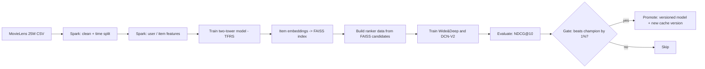
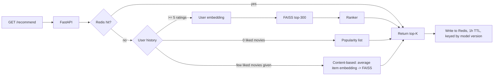

# Two-Stage Recommendation Engine (MovieLens 25M)

A two-stage recommender in the style of large streaming and e-commerce systems.
**Stage 1 (retrieval)** quickly finds 300 candidate movies per user with a two-tower neural network and FAISS.
**Stage 2 (ranking)** re-scores those candidates with a deep ranking model (Wide & Deep or DCN-V2).
New users are handled by popularity and content-based fallbacks, results are cached in Redis, and the whole pipeline is orchestrated with Airflow.

> **Status:** data pipeline, retrieval, FAISS, rankers, cold start, Redis cache, FastAPI service, tests, simulated A/B test, the Airflow DAG and an ONNX export of the ranker are implemented and were run. The **Triton model repository and config are built and committed, but the Triton server itself was not run**: its container image did not fit on the 32 GB development codespace (see "Known gaps").

## 1. Architecture

### Offline pipeline (scheduled weekly by Airflow)



### Online request path



## 2. Data and the time split

- Dataset: MovieLens 25M (GroupLens). Ratings, not clicks.
- Label: `rating >= 4` counts as "liked".
- Cleaning: duplicates removed, users with fewer than 5 ratings dropped.
- Because of compute limits, **20,000 randomly sampled users** are used (about 3.18 million ratings).
- **Split by time, not randomly**, at the 80% and 90% timestamp quantiles:

| Split | Rows | Time range |
|---|---|---|
| Train | 2,548,800 | Feb 1996 to Jul 2016 |
| Validation | 315,344 | Jul 2016 to Dec 2017 |
| Test | 319,520 | Dec 2017 to Nov 2019 |

All features are computed from the **train** period only, so nothing from the future leaks into training.

### Data files (`data/processed/`, not committed to Git)

| File | Columns |
|---|---|
| `train/val/test.parquet` | userId, movieId, rating, timestamp, label |
| `movies.parquet` | movieId, title, genres, genres_list, year |
| `item_features.parquet` | movieId, pop_all, avg_rating, pop_recent, avg_rating_smooth, genres_list, year |
| `user_features.parquet` | userId, n_ratings, user_avg_rating, user_rating_std, last_ts |
| `user_genre_affinity.parquet` | userId, genre, count, share |
| `user_history.parquet` | userId, recent_items (last 20 liked) |
| `popularity_global.parquet` | top 500 items by recent popularity |
| `ranker_train/test.parquet` | userId, movieId, label + 11 ranking features |

Ranker features: retrieval score, retrieval rank, genre affinity (user taste x movie genres), log popularity (all-time and recent), smoothed average rating, release year, log user rating count, user average rating, user rating std, rating gap (movie average minus user average).

## 3. Models

- **Two-tower retrieval (TensorFlow Recommenders):** user and item towers with 64-d L2-normalised embeddings, in-batch negatives with popularity (logQ) correction, temperature 0.05, batch 4096, 5 epochs. Towers use IDs only. 17,065 users and 16,500 movies were embedded.
- **FAISS:** exact `IndexFlatIP` and approximate `IndexHNSWFlat`.
- **Rankers:** Wide & Deep (linear + hand-made crosses + MLP) and DCN-V2 (two cross layers + MLP), trained with binary cross-entropy on FAISS candidates, labelled by what the user liked in the *next* time window. The Wide & Deep model is also exported to ONNX.
- **Cold start:** 0 history -> recent-popularity list; a few liked movies -> average of their item embeddings searched in FAISS; 5+ ratings -> full pipeline.

## 4. Results

All numbers come from the scripts in this repo on the 20,000-user sample.

### Stage 1: retrieval (621 validation users, already-seen movies excluded)

| | Recall@10 | Recall@50 | Recall@100 | Recall@300 |
|---|---|---|---|---|
| Two-tower | 0.049 | 0.174 | 0.271 | 0.468 |
| Popularity baseline | 0.030 | 0.098 | 0.156 | 0.278 |

### FAISS (1,000 queries, K=300)

| Index | ms / query | Recall vs exact |
|---|---|---|
| Flat (exact) | 0.190 | 1.000 |
| HNSW | 0.181 | 0.940 |

### Stage 2: ranking (472 test users, 414 with at least one liked candidate; metrics within the 300 candidates)

| Method | NDCG@10 | Recall@10 | AUC |
|---|---|---|---|
| Popularity | 0.108 | 0.071 | 0.601 |
| Retrieval order | 0.163 | 0.118 | 0.589 |
| Wide & Deep | **0.176** | **0.150** | **0.697** |
| DCN-V2 | 0.175 | 0.143 | 0.695 |

Candidate recall@300 (share of later-liked movies that retrieval put in the 300 candidates): 0.42 (pooled). This is the ceiling for the ranker.

### Simulated A/B test (clicks are simulated, see limitations)

Users are split 50/50 by hash of user id. A shown movie is clicked with probability 0.60 if the user liked it later, otherwise 0.02, both divided by log2(rank+1).

| Comparison | CTR A | CTR B | p-value |
|---|---|---|---|
| Retrieval-only vs Wide & Deep | 4.69% (241 users) | 3.85% (231 users) | 0.156 |
| Wide & Deep vs DCN-V2 | 4.65% (241 users) | 4.24% (231 users) | 0.500 |

Neither difference is significant. A paired analysis (every model scored on the same 472 users, expected CTR) gives:

| Model | Expected CTR |
|---|---|
| Popularity | 0.0298 |
| Retrieval-only | 0.0399 |
| Wide & Deep | 0.0407 |
| DCN-V2 | 0.0406 |

Only retrieval vs popularity is significant (+0.0101, 95% CI +0.0066 to +0.0136). The rankers are not distinguishable from retrieval-only or from each other on this sample.

### System performance (400 requests drawn from 150 users, plus 40 cold-start requests)

| Route | n | p50 (ms) | p95 (ms) |
|---|---|---|---|
| Redis cache hit | 258 | 0.20 | 0.87 |
| Full two-stage pipeline | 142 | 7.33 | 33.41 |
| Cold start, content-based | 20 | 3.65 | 9.94 |
| Cold start, popularity | 20 | 0.42 | 1.11 |

Pipeline stage times (p50 / p95 ms): FAISS 3.54 / 16.24, features 1.18 / 5.56, ranker 1.54 / 9.82. The cache hit rate of 58.6% reflects the test's repeated users, not real traffic. Timings are measured inside the recommender (no HTTP overhead). A repeat run in a busier session gave a pipeline p50 of 14.6 ms (FAISS 8.7 ms), so absolute timings vary with machine load; the ranker benchmark below runs both backends in one process for a fair comparison.

### Ranker backend: TensorFlow SavedModel vs ONNX Runtime

The Wide & Deep ranker was exported to ONNX (`tf2onnx`, opset 13; input `features` [batch, 11], output `score` [batch, 1]). The exported model matches the trained model to within 1.8e-7 on test inputs. Benchmark: 200 requests of 300 candidates x 11 features, 3 passes after a 30-request warm-up, CPU, one process (`python -m serving.bench_backends`). It times the model call only; FAISS and feature building are not included.

| Backend | p50 (ms) | p95 (ms) |
|---|---|---|
| TensorFlow SavedModel | 0.53 | 0.99 |
| ONNX Runtime | 0.18 | 0.38 |

The API uses the ONNX ranker when started with `RANKER_BACKEND=onnx`.

### Tests

`python -m pytest -q` -> **9 passed** (metric functions with hand-computed NDCG values, cache round trip and version isolation, API health, full-pipeline route, both cold-start routes).

## 5. How to run

Developed in a GitHub Codespace (Python 3.11, Java 17 for Spark; see `.devcontainer/devcontainer.json`).

```bash
# 1. environment
python -m venv .venv && source .venv/bin/activate
pip install -r requirements.txt

# 2. data (about 250 MB)
mkdir -p data/raw && cd data/raw
wget https://files.grouplens.org/datasets/movielens/ml-25m.zip
python -m zipfile -e ml-25m.zip . && cp ml-25m/ratings.csv ml-25m/movies.csv . && cd ../..

# 3. pipeline (run in this order, from the project root)
python spark_jobs/build_interactions.py     # clean, sample 20k users, time split
python spark_jobs/build_features.py         # user / item features
python retrieval/two_tower.py               # train retrieval model
python eval/eval_retrieval.py               # Recall@K vs popularity
python retrieval/build_faiss.py             # FAISS indexes + benchmark
python ranking/build_ranker_data.py         # candidates + labels + features
python ranking/train_ranker.py              # Wide&Deep and DCN-V2
python eval/ab_test.py                      # simulated split-traffic A/B test
python eval/ab_paired.py                    # paired comparison

# 4. serving
sudo apt-get install -y redis-server && redis-server --daemonize yes
uvicorn serving.api:app --host 0.0.0.0 --port 9000
python serving/load_test.py                 # in a second terminal
python -m pytest -q                         # tests/ only (see pytest.ini)

# ONNX ranker (use a separate virtual environment for the conversion tools:
# installing tf2onnx / onnx into the main one upgrades numpy and breaks TensorFlow 2.15)
pip install "onnxruntime==1.18.1" "numpy==1.26.4" "protobuf==4.25.9" "ml-dtypes==0.3.2"
RANKER_BACKEND=onnx uvicorn serving.api:app --host 0.0.0.0 --port 9000
python -m serving.bench_backends            # TensorFlow vs ONNX ranker latency

# Triton (needs Docker and roughly 25+ GB of free disk; not run in this project)
python serving/prep_check.py                # writes sample inputs to /tmp
bash serving/start_triton.sh
python serving/triton_check.py
```

### Airflow (separate virtual environment)

```bash
python -m venv /workspaces/airflow_venv && source /workspaces/airflow_venv/bin/activate
pip install "apache-airflow==3.4.0" --constraint \
  "https://raw.githubusercontent.com/apache/airflow/constraints-3.4.0/constraints-3.11.txt"
export AIRFLOW_HOME=/workspaces/airflow_home
export AIRFLOW__CORE__DAGS_FOLDER=$PWD/airflow/dags
export AIRFLOW__CORE__LOAD_EXAMPLES=False
airflow standalone          # UI on port 8080
```

DAG `reco_retrain` (weekly): spark_interactions -> spark_features -> train_retrieval -> build_faiss -> ranker_data -> train_ranker -> evaluate -> gate -> promote | skip.
The gate promotes only if the new ranker's NDCG@10 beats the current champion by more than 1%. The first run compares against the retrieval-only baseline. Promotion saves a versioned copy under `model_repo/live/ranker/<n>/` and updates `model_repo/live/VERSION`, which is part of the cache key, so old cached recommendations are ignored.

## 6. API

Interactive docs: `http://localhost:9000/docs`

| Endpoint | Purpose |
|---|---|
| `GET /health` | status, cache backend, model version |
| `GET /recommend?user_id=1&k=10&liked=1,260,296` | top-K recommendations; `liked` is an optional comma-separated list of movieIds for a new user |
| `GET /stats` | cache hit rate, p50/p95 latency per route and per pipeline stage |
| `POST /cache/flush` | clear cached recommendations and counters |

Example response fields: `source` (`two_stage`, `cache`, `cold_content`, `cold_popular`), `ms`, `items` (movieId, title), and `stages` (faiss, features, ranker milliseconds) for pipeline calls.

## 7. Known gaps and limitations

- **Triton Inference Server was configured but not run.** `model_repo/triton/ranker/` holds the ONNX model (`1/model.onnx`) and `config.pbtxt` for Triton's ONNX Runtime backend, with `serving/start_triton.sh` to launch the server and `serving/triton_check.py` to compare Triton's scores with the stored ones and time requests. Pulling the Triton container (`nvcr.io/nvidia/tritonserver:26.08-py3`) failed with "no space left on device" on the 32 GB codespace after using about 14.5 GB. Until it is run on a machine with more disk, the API serves the same ONNX file in-process through ONNX Runtime.
- **The Airflow DAG has been tested task by task** (`evaluate`, `promote`) with `airflow tasks test`. A full end-to-end run is not recorded here yet.
- **Clicks are simulated.** MovieLens has ratings only. The A/B test demonstrates the method and analysis, not real user behaviour.
- **Small ranker sample.** Only 472 test users (about 141,000 rows, about 3% positives) qualify, because most users rate in short bursts and few have ratings in later windows. Metric differences between the two rankers are within noise.
- **Towers use IDs only.** Retrieved neighbours lean towards popular movies. Adding genre and year to the item tower is the first improvement to try.
- **Within-user click correlation** is ignored by the z-test, which makes it slightly optimistic.

## 8. Next steps

Genre / year / tag features in the towers; more users and a listwise ranking loss; running the prepared Triton deployment on a machine with more disk; real click logs and an online A/B test; a feature store for serving-time features.
